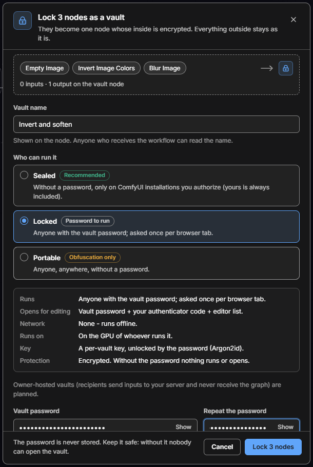
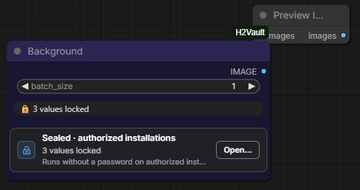

# ComfyUI-H2Vault

Protect the parts of a ComfyUI workflow you do not want copied, and still share the workflow.

- **Vaults**: select some nodes (or a group, or a subgraph) and protect them. They become one node whose inside is
  encrypted. It runs with ComfyUI's own scheduler like any subgraph, and its outputs feed the rest of the graph as before.
  Opening it needs the vault password and a second factor: an authenticator app, a passkey / security key / Windows
  Hello, a backup password or a recovery code - the vault's author chooses which.
- **Encrypted workflow files**: save the whole workflow as one encrypted file, opened with a key or a password.
  Files are compatible with [ComfyUI-Workflow-Encrypt](https://github.com/jtydhr88/ComfyUI-Workflow-Encrypt).
- **Concealed vaults (model and node identity)**: the person who runs a concealed vault sees only its title, its socket
  labels and the controls its author exposed - sampler, scheduler, steps, cfg, seed, denoise, sizes, prompts and
  "Model A / Model B". No model file name, node type or inner node name reaches their screen, saved workflow, history,
  job list, console or error messages while it runs.

## Install

- **ComfyUI Manager / comfy-cli** (once H2Vault is published on the Comfy Registry): search for "H2Vault", or
  `comfy node install ComfyUI-H2Vault`, then restart ComfyUI.
- **git**: in `ComfyUI/custom_nodes`, run `git clone https://github.com/Code2Collapse/ComfyUI-H2Vault`, then
  `<ComfyUI python> -m pip install -r ComfyUI-H2Vault/requirements.txt` and restart ComfyUI.

A git clone creates `custom_nodes/ComfyUI-H2Vault`; ComfyUI Manager and `comfy node install ComfyUI-H2Vault` create
the same folder. Install it once.

Requirements: `cryptography` 44 or newer (the only dependency; it never touches torch or numpy). Optional: `keyring`, to
keep H2Vault's local secrets in the operating system's credential store.

## Protect nodes (artists)

1. Select the nodes, or a group.
2. Right-click one of them and choose **Protect with H2Vault (sealed, authorized installations)** or **Protect with
   H2Vault (locked, password to run)**. The same actions are in the **H2Vault** menu and the command palette.
3. The dialog shows what becomes the vault, lets you name it, and explains who can run it. Type a password twice (or
   let it generate one) and press **Lock**.

The nodes become one vault node, wired exactly as before. Protecting is one undo step. If anything fails on the way,
your nodes are put back exactly as they were and the dialog says what happened.

**Run it**: a Sealed vault simply runs on your installation and on the installations you authorized. A Locked vault
asks for its password once per browser tab.

**Open it**: double-click the vault (or press **Open...** on its card), type the password and confirm with your second
factor - the dialog offers the methods set up on this installation that the vault accepts, starting with the one you
used last. The real nodes open as a subgraph; edit them. When you leave the subgraph, the vault is encrypted again at
once. The first time on an installation, H2Vault asks you to set up a second factor.

**Second factor** (H2Vault menu › Second factor): set up any of
- an **authenticator app** (TOTP; codes 30 s early or late are accepted, each code works once),
- **passkeys / security keys / Windows Hello** (WebAuthn; browsers allow them only on a name, so open ComfyUI as
  `http://localhost:<port>`, not `http://127.0.0.1:<port>`; a passkey belongs to the address it was made on),
- a **backup password** (a second secret, different from your vault passwords),
- **recovery codes** (8 single-use codes, shown once with a .txt download; "Generate a new set" replaces them).
Changing them needs one of your methods first. Each vault records which methods may open it (lock dialog and
*Manage access*: "Second factor for editing"); recovery codes are always accepted. Vaults locked before this accept the
authenticator app and recovery codes. Email and SMS codes are not offered: they need a mail / SMS provider and a
server online, and H2Vault works offline. **Lost every method?** The administrator of the computer starts ComfyUI once
with `H2VAULT_RESET_SECOND_FACTOR=remove-all` (then removes it and restarts): every method is removed, nothing else.

H2Vault's password boxes never make the browser offer to save a password (masked text inputs plus the opt-outs of
1Password, LastPass, Bitwarden and Proton Pass). A Locked vault's password is asked once per browser tab; reloading
the tab keeps the unlock (the server waits 2 minutes before forgetting a tab that unloaded).

| You want | Choose |
|---|---|
| To share a workflow that runs on your machine and on machines you approve, without telling anyone a password | **Sealed - authorized installations** (default) |
| Anyone who knows the password to run it | **Locked - password to run** |
| It to run anywhere, and you accept that a knowledgeable person can extract it | **Portable** (obfuscation only) |

To let another installation run a Sealed vault: on that machine, right-click any vault > **My installation code**
(or H2Vault menu > My installation code), send the code (a public key, safe to share) or the key file, and paste it
under "Other installations" when you protect, or later in **Manage installations & editors**.

When a vault needs custom nodes a machine lacks, the run says how many packs are missing and from which hosts (never
their names), and offers **Install missing custom nodes** - only after a click, from github.com / gitlab.com /
codeberg.org / bitbucket.org, at the commit the author used. Install their Python requirements with ComfyUI Manager.

## Concealed vaults: share a pipeline without revealing its models or nodes

A vault can be sealed as **concealed**. Its author chooses the controls to expose; everything else stays inside the
encrypted payload:

- The recipient's vault node shows the title, the socket labels and the exposed controls only. Model choices appear as
  aliases ("Model A", "Model B"); the real file names are resolved on the server, inside the vault.
- Sealing refuses what would give the inside away: labels that name it, outputs that hand out a model / CLIP / VAE,
  and choice lists that show file names.
- While a concealed vault runs, the server rewrites progress, results, history, job list and errors so they name only
  the vault (errors become a plain sentence without a traceback), and console lines printed by its inner nodes become
  `[H2Vault] concealed output` - in the console, in the log panel and in log files ComfyUI writes with
  `--verbose LEVEL FILE`. An error names only the kind of step that failed ("failed step: Decoding").
- While it runs, the vault node shows **what the current step does in simple words** - "Loading models", "Preparing prompts", "Sampling", "Decoding", "Upscaling", "Saving results" - and "step 2 of 4". The words come from the kind of data a step takes and makes, never from its name, so they cannot reveal a node pack or a model. The step count counts these kinds of work,
  not the nodes inside, so it does not tell how big the inside is.
- **Hosted mode** (`H2VAULT_HOSTED=1`, for a render server you operate): model lists are emptied, the log and model-list
  routes are refused and only vault prompts are accepted.

Checked live (ComfyUI 0.39, frontend 1.53.10, both renderers, at the top level and inside a subgraph): nothing about
the inside reached the recipient, and a concealed run gives the same pixels as the same graph unconcealed.

**Conceal a vault**: in the protect dialog switch on **Conceal models and nodes**. The **Choose what to expose** list
shows every setting inside, grouped as sampler, scheduler, steps, cfg, seed, denoise, sizes, prompts, model choices and
other settings; the usual ones are ticked already. Rename what the recipient sees, tick a model choice to offer it as
named choices ("Model A", "Model B", or names you pick, each mapped to one of your files), and name the sockets.
**Preview as recipient** beside the list shows the vault exactly as the recipient will get it, checked by the same rules
as sealing; a name that would give the inside away is marked and must be changed before **Lock** works. Everything is
reachable with the keyboard. An editor who opens a concealed vault can remove the concealment (right-click inside it ›
**Remove concealment from this vault…**, after a confirmation); copies already sent stay concealed.

What concealment cannot hide on the recipient's own machine: code running in the same Python process (another custom
node, a debugger) can read the decrypted inside; the model files must be on their disk, and a file hash identifies a
public model; run time, step counts and comparing many outputs hint at the model. For real secrecy run the vault in
Hosted mode on a server you operate, behind your own login.

## A vault prepares itself: missing models and extensions arrive by themselves

A vault can carry, inside its encryption, where to download each model file it uses (URL, size, SHA-256). When
someone opens the workflow on a ComfyUI that lacks a model, H2Vault downloads it in the background - over HTTPS only,
resumable, capped at the declared size and checked against the SHA-256 before use - and stores it under a hash name
(`models/<folder>/h2v/<hash>.<ext>`). Model lists in the browser (node menus, the model library, `/object_info`,
`/models`, `/api/assets`) never show these copies, and their file metadata is not served. The vault node shows only
"Preparing this vault · 42 %"; the browser never learns a file name, URL or folder. Missing extensions install from
the commits pinned inside the vault (they are code: ComfyUI needs a restart). Setting *H2Vault > Run > Install what a
vault needs*: Install automatically (default) / Ask first / Never.

**For authors:** the protect dialog lists the model files your selection uses under *Downloads for people who run
it*; paste an https:// link for each. H2Vault reads the size and SHA-256 from your own copy when it locks the vault.
Someone watching the machine's network or disk can still see download
hosts and sizes, and a public model can be recognised by its hash.

## Lock parameters: keep a node, hide its values

Right-click a node (or a selection, or a group) > **Lock parameters...**. Each node stays where it is, with its title,
colours and sockets; the values you tick are encrypted inside it, the ones you leave open stay editable. By default
every value is locked, and the node shows only its title and *3 values locked* - tick *Show the names of the locked
settings* or *Show what kind of node each one is* only if others may see them (otherwise even an error names only the
vault, and a node whose title is still its kind - "Load Checkpoint" - is shown as *Locked node*). Underneath, a Locked node is a one-node vault, so it uses the same profiles (Sealed, Licensed, Locked), runs on
ComfyUI's own scheduler and keeps its values out of the workflow file, PNG metadata, the queue and history. While it
runs, its locked values are blanked (`•••`) in error messages, progress text, text outputs and the server log. Nodes
locked together share their password: one prompt per browser tab unlocks the set. Right-click > **Unlock parameters
(remove protection)...** (password + authenticator) puts the original node back for good.

## Licences: one workflow for everyone, one licence per installation

Protect with **Licensed - one licence per installation**. Share the workflow as widely as you like: it runs only on
installations you send a licence to (yours gets one automatically). Each person sends you their installation code
(right-click a vault > My installation code); right-click the vault > **Issue a licence...** (password +
authenticator) gives a short `h2vl1:` text or a `.h2vlicence` file - valid until a date and/or for a number of runs,
if you like. They add it with right-click > **Add licence...**; the vault node then shows *Licensed on this
installation* with the end date and the runs left. **Revoke licences (new licence key)...** re-seals the vault and
re-issues licences to the people you tick; **H2Vault > Licences issued** lists everything you issued; **Back up my
author key** keeps the key that signs your licences (without it you cannot issue licences for workflows you already
shared). Nothing is sent anywhere: there is no licence server.

What licences are: a way to stop **casual sharing** of the workflow file - passed on without a licence for the
receiving installation, it does not run. What they are not: copy protection. A workflow has ONE licence key, shared
by everyone you licensed; any of them can, with effort, extract it on their own machine and pass it on (a modified
H2Vault then runs the copy anywhere). Revoking someone means a new licence key and sending the new copy only to the
others.

| What a licence does | How |
|---|---|
| The workflow file alone does not run on an installation without a licence for it | The vault's data key is wrapped only under its licence key; the licence key travels only inside licences, wrapped to one installation's own X25519 key. **Not** proof against a licensee: they hold the licence key and can extract it |
| A licence works on one installation and for one workflow only | That installation's private key is needed to unwrap it; the licence names the workflow |
| Only you can issue licences | Ed25519 signature checked against your author key, which is bound into the vault (authenticated, cannot be swapped) |
| After *Revoke licences*, the new copy refuses the old licences | A new licence key |
| **Honour-system only:** end dates, run limits, the clock check, newest licence wins (the newest licence for a copy decides; an older one is never used instead) | Kept by the unmodified H2Vault on the other person's computer. Someone who changes software on their own machine can ignore them, and can keep running a copy they already hold. For limits that are truly enforced, run the vault on your own server (Hosted mode). |

**Revoking resets run limits:** *Revoke licences* re-issues new licences to the people you tick, and a re-issued
licence counts its runs from zero again (same end date, same limit).

**Author key backup and restore** ask for the password of one of your Licensed vaults and your authenticator code,
like issuing a licence; a backup can only be restored for workflows it signed. Replacing a different author key
needs an explicit tick, and the key it replaces is saved first to `ComfyUI/user/h2vault/author-key-backup-<date>-<id>.h2vauthor`
(encrypted with the same backup password). Protecting as Licensed (which creates your author key) and every licence
action answer only the ComfyUI page on this machine.

## Encrypted workflow files

- **H2Vault > Save workflow encrypted...**: choose **A key** (a random key, shown once - copy it or save it as a file;
  this installation can remember it) or **A password**. The file `<name>.h2vault.json` downloads.
- **Open it**: drag the file onto ComfyUI, or **Workflow > Open**, or **H2Vault > Open encrypted workflow...**. If this
  installation remembers the key it opens directly; otherwise it asks for the key or password. The decrypted workflow
  opens in a new, unsaved tab, so saving never overwrites the encrypted file.
- **Workflow-Encrypt files**: an `encrypted_data.txt` made by ComfyUI-Workflow-Encrypt opens with **H2Vault > Open
  encrypted workflow...** and its key; **Export for Workflow-Encrypt** in the key dialog writes a file that extension
  opens.

- **H2Vault > Remembered workflow keys...** lists the remembered keys by name (never the key) and forgets them.
- **H2Vault > Save workflow encrypted again (same key)**: after editing a workflow you opened from an encrypted file,
  save it with the same key (only a key this installation remembers; it never travels to the page) or password, so
  the people who have the key can open the new file too.

Once opened, the workflow is an ordinary workflow again. Protect the parts that must stay hidden with a vault.
**Images are not covered:** ComfyUI writes the workflow and the prompt into every PNG it saves, so images rendered
from a decrypted workflow carry it in readable form. Keep a pipeline out of images by protecting its nodes as a vault
(a vault's inside never reaches image metadata), or start ComfyUI with `--disable-metadata`. While a decrypted
workflow is open, the ComfyUI front end keeps a draft of it in this browser's storage.

## What it protects, and what it does not (for a CTO)

| Asset | Protection |
|---|---|
| The inside of a vault (nodes, wiring, values, model names) | AES-256-GCM. Locked: key from Argon2id(password). Sealed: a per-vault key wrapped with X25519 for each authorized installation, and with the password for editing. The header (format, vault id, KDF parameters, interface hashes) is authenticated. |
| Opening a vault for editing | Password + a second factor the vault accepts (TOTP RFC 6238 single-use codes, WebAuthn passkeys with signature-counter check, a backup password, single-use recovery codes; backup password and recovery codes stored as scrypt hashes) + the vault's editor list. 5 wrong passwords lock that vault for 5 minutes and each further one doubles the wait (max 1 h); wrong second factors likewise per vault and across vaults; one key derivation at a time. |
| Workflow JSON, PNG metadata, history, logs, the queued prompt | The vault node carries only the encrypted payload and its public sockets / controls. Images and other files saved or previewed INSIDE a vault carry no workflow or prompt metadata. Server messages about inner nodes are rewritten to the vault; errors keep the inner node type and the message, never values or tracebacks (a concealed vault: only the kind of step). |
| Local secrets (install key, TOTP secret, remembered keys) | OS credential store (keyring) or an encrypted file in `ComfyUI/user/h2vault/`. Never in a workflow, log or git. |
| Routes that set up the second factor, manage remembered keys, licences or the author key, or install custom nodes | Answer only the ComfyUI page on the same machine (loopback peer + loopback Host + no cross-site request). |
| Licences (Licensed profile) | Ed25519-signed, offline, bound to one installation's X25519 key; the vault opens only with a licence key unwrapped there. End dates and run limits are honour-system (see *Licences*). |
| Locked nodes | One-node vaults: values only in the ciphertext; blanked in messages and the log while they run. |
| Passwords typed on a remote page over plain http | Every password field warns that the password travels unencrypted (use an SSH tunnel or https). |

### Limits of Lock parameters' blanking

While a Locked node runs, its OWN messages (its error text, progress text, text outputs and history) lose every
locked value - strings in their common spellings (as typed, escaped, with / or \\, any letter case), numbers in any
decimal spelling (7.5, 7.50, 7.5e0), True / False. The rest of the server log (logging records and `print()` output,
through ComfyUI 0.39's stdout / stderr interceptor that feeds `/internal/logs`) loses only locked text values of 3+
characters: blanking a locked `1` in every log line would hide everything else. Not covered: log handlers that
write elsewhere than stdout / stderr (e.g. a file handler another extension adds), encodings other than those above
(hex, base64, a value split across lines), and anything reading process memory. Older H2Vault versions (0.1.x)
refuse a Locked node ("made by a newer H2Vault"), so it never runs there without the blanking.

Honest limits: a machine that runs a vault has to decrypt its inside to run it, so someone who controls that machine
(memory, a debugger, a modified ComfyUI) can read it. A Locked vault can be decrypted by anyone with its password. A
Portable vault is obfuscation only. An opened encrypted workflow file is plaintext in that browser.

Design, module map and threat notes: [docs/ARCHITECTURE.md](docs/ARCHITECTURE.md).

## Settings

ComfyUI Settings > H2Vault:
- **Protect > Default profile**: which profile the subgraph protect dialog starts on.
- **Encrypted workflows > Remember keys**: whether new workflow keys are remembered by default.

Environment variables: `H2VAULT_NATIVE=off` stops vaults from running; `H2VAULT_INSTALL=off` turns off the consent
install; `H2VAULT_SECRETS_BACKEND=file` keeps secrets in the encrypted file instead of the OS store;
`H2VAULT_SECRETS_PASSPHRASE` sets that file's passphrase.

## Using it next to ComfyUI-CustomNodePacks (C2C Vault)

H2Vault is a separate product with its own node ids, routes, settings, storage and file format, so both can be
installed together. A vault made by one is opened by that one; H2Vault refuses to put a C2C Vault inside an H2Vault.

## Licence

AGPL-3.0 (see LICENSE). H2Vault ports ComfyUI-Workflow-Encrypt by jtydhr88 (AGPL-3.0) and derives from the C2C Vault of
Code2Collapse ComfyUI-CustomNodePacks (Apache-2.0); see NOTICE.

## Readable in light and dark themes (2026-11-23)

Node panels from this pack were checked in both renderers, light and dark themes, two display scales and three zoom
levels. Dim text, badges and chips now reach the WCAG contrast of 4.5:1, and the C2C colours apply wherever a panel is
shown. Saved workflows are unchanged.

## Lock dialog: outputs judged by what they carry (2026-11-23)

A wildcard (*) output, for example from a switch node, no longer blocks locking when it carries an image or mask; a
real model output (also custom ones like SeC) is caught and named. Every problem sits on its output row with a fix:
remove the output, show it as its real type, or lock without concealment. The vault also checks output values when it
runs and stops if one would hand out a model.

## Second factor: your choice per vault, no save-password prompts (2026-11-23)

- Pick which methods may open a vault for editing: authenticator app, passkey / security key / Windows Hello, backup
  password, and recovery codes (always accepted as the fallback). Old vaults keep the authenticator + recovery codes.
- Recovery codes can be entered wherever the second factor is asked; the dialog says how many are left and makes a
  new set (shown once, downloadable). Passkeys need http://localhost:PORT (browsers refuse them on 127.0.0.1).
- Password boxes no longer trigger the browser's "Save password?" prompt, and a page reload no longer asks again for
  a Locked vault's password.

## Previews from inside show on the vault (2026-11-23)

Lock preview or save nodes inside a vault and their results appear on the vault node when you queue it:

- **Images** (Preview Image, Save Image, any node that shows images): ComfyUI's own image preview on the vault, all of
  them together (several preview nodes inside = one gallery), in classic and Nodes 2.0.
- **Videos, audio, text** (VHS Video Combine, Save Video, Save Audio, "show text" nodes): a *Previews from inside*
  panel on the vault plays and shows them.
- **Live sampler previews** of a sampler inside the vault, also with KJNodes' **Model Preview Override** (its live
  frames show in the vault's panel, with the step count).
- **Progress**: the vault's bar follows the step that runs inside (a sampler's steps).
- **Cached runs**: when ComfyUI serves the vault from its cache, its previews come back too.

Each preview is labelled **Preview 1, Preview 2, ...** (the inner graph's order) or with a name you give in the lock
dialog (*Previews › Preview names*) - never with an inner node's name, type or id. The lock dialog has **Show previews
from inside on the vault** (on by default); off, nothing from inside shows and the vault's card says so. Inside an open
vault, right-click the canvas › *Previews on the vault…* changes it. The setting and the names are stored inside the
encryption.

What a preview can say: saved files keep the file name prefix / folder you set (the person who runs the vault sees
them in their output folder anyway; the dialog warns when a prefix is your own), and a text preview shows its text.
VHS's server file path is not passed on, nor KJNodes' sigma schedule. Concealed vaults show only the previews their
author ticked, saved under H2Vault's own neutral file prefix. Kinds the panel cannot show (anything that is not an image, video,
audio or text) are named by label and counted, never dropped silently.
