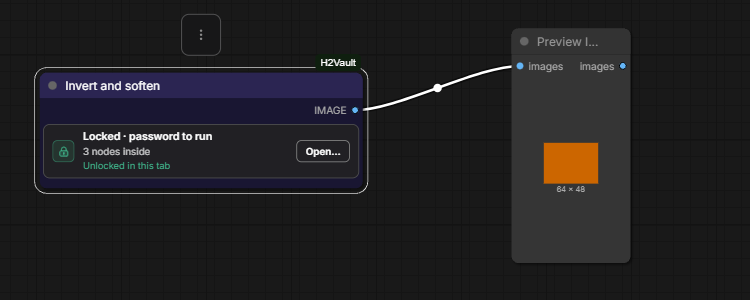
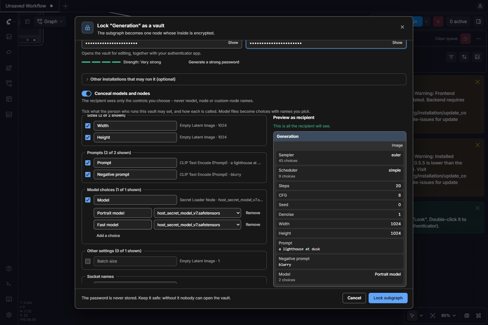
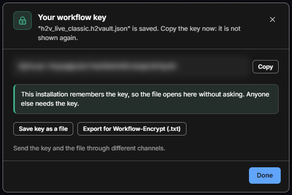

# ComfyUI-H2Vault

Protect the parts of a ComfyUI workflow you do not want copied, and still share the workflow.

- **Vaults**: select some nodes (or a group, or a subgraph) and protect them. They become one node whose inside is
  encrypted. It runs with ComfyUI's own scheduler like any subgraph, and its outputs feed the rest of the graph as before.
  Opening it needs the vault password and a code from your authenticator app.
- **Encrypted workflow files**: save the whole workflow as one encrypted file, opened with a key or a password.
  Files are compatible with [ComfyUI-Workflow-Encrypt](https://github.com/jtydhr88/ComfyUI-Workflow-Encrypt).
- **Concealed vaults (model and node identity)**: the person who runs a concealed vault sees only its title, its socket
  labels and the controls its author exposed - sampler, scheduler, steps, cfg, seed, denoise, sizes, prompts and
  "Model A / Model B". No model file name, node type or inner node name reaches their screen, saved workflow, history,
  job list, console or error messages while it runs.

## Install

- **ComfyUI Manager / comfy-cli** (once H2Vault is published on the Comfy Registry): search for "H2Vault", or
  `comfy node install ComfyUI-H2Vault`, then restart ComfyUI.
- **git**: in `ComfyUI/custom_nodes`, run `git clone https://github.com/Code2Collapse/ComfyUI-H2Vault`, then
  `<ComfyUI python> -m pip install -r ComfyUI-H2Vault/requirements.txt` and restart ComfyUI.

A git clone creates `custom_nodes/ComfyUI-H2Vault`; ComfyUI Manager and `comfy node install ComfyUI-H2Vault` create
the same folder. Install it once.

Requirements: `cryptography` 44 or newer (the only dependency; it never touches torch or numpy). Optional: `keyring`, to
keep H2Vault's local secrets in the operating system's credential store.

## Protect nodes (artists)

1. Select the nodes, or a group.
2. Right-click one of them and choose **Protect with H2Vault (sealed, authorized installations)** or **Protect with
   H2Vault (locked, password to run)**. The same actions are in the **H2Vault** menu and the command palette.
3. The dialog shows what becomes the vault, lets you name it, and explains who can run it. Type a password twice (or
   let it generate one) and press **Lock**.

The nodes become one vault node, wired exactly as before. Protecting is one undo step. If anything fails on the way,
your nodes are put back exactly as they were and the dialog says what happened.

**Run it**: a Sealed vault simply runs on your installation and on the installations you authorized. A Locked vault
asks for its password once per browser tab.

**Open it**: double-click the vault (or press **Open...** on its card), type the password and the 6-digit code from
your authenticator app. The real nodes open as a subgraph; edit them. When you leave the subgraph, the vault is
encrypted again at once. The first time on an installation, H2Vault walks you through setting up the authenticator
(scan the QR code, save the recovery codes, type a code).

| You want | Choose |
|---|---|
| To share a workflow that runs on your machine and on machines you approve, without telling anyone a password | **Sealed - authorized installations** (default) |
| Anyone who knows the password to run it | **Locked - password to run** |
| It to run anywhere, and you accept that a knowledgeable person can extract it | **Portable** (obfuscation only) |

To let another installation run a Sealed vault: on that machine, right-click any vault > **My installation code**
(or H2Vault menu > My installation code), send the code (a public key, safe to share) or the key file, and paste it
under "Other installations" when you protect, or later in **Manage installations & editors**.

When a vault needs custom nodes a machine lacks, the run says how many packs are missing and from which hosts (never
their names), and offers **Install missing custom nodes** - only after a click, from github.com / gitlab.com /
codeberg.org / bitbucket.org, at the commit the author used. Install their Python requirements with ComfyUI Manager.

## Concealed vaults: share a pipeline without revealing its models or nodes

A vault can be sealed as **concealed**. Its author chooses the controls to expose; everything else stays inside the
encrypted payload:

- The recipient's vault node shows the title, the socket labels and the exposed controls only. Model choices appear as
  aliases ("Model A", "Model B"); the real file names are resolved on the server, inside the vault.
- Sealing refuses what would give the inside away: labels that name it, outputs that hand out a model / CLIP / VAE,
  and choice lists that show file names.
- While a concealed vault runs, the server rewrites progress, results, history, job list and errors so they name only
  the vault (errors become a plain sentence without a traceback), and console lines printed by its inner nodes become
  `[H2Vault] concealed output`.
- While it runs, the vault node shows **what the current step does in simple words** - "Loading models", "Preparing prompts", "Sampling", "Decoding", "Upscaling", "Saving results" - and "step 3 of 7". The words come from the kind of data a step takes and makes, never from its name, so they cannot reveal a node pack or a model.
- **Hosted mode** (`H2VAULT_HOSTED=1`, for a render server you operate): model lists are emptied, the log and model-list
  routes are refused and only vault prompts are accepted.

Checked live (ComfyUI 0.39, frontend 1.53.10, both renderers, at the top level and inside a subgraph): nothing about
the inside reached the recipient, and a concealed run gives the same pixels as the same graph unconcealed.

**Conceal a vault**: in the protect dialog switch on **Conceal models and nodes**. The **Choose what to expose** list
shows every setting inside, grouped as sampler, scheduler, steps, cfg, seed, denoise, sizes, prompts, model choices and
other settings; the usual ones are ticked already. Rename what the recipient sees, tick a model choice to offer it as
named choices ("Model A", "Model B", or names you pick, each mapped to one of your files), and name the sockets.
**Preview as recipient** beside the list shows the vault exactly as the recipient will get it, checked by the same rules
as sealing; a name that would give the inside away is marked and must be changed before **Lock** works. Everything is
reachable with the keyboard. An editor who opens a concealed vault can remove the concealment (right-click inside it ›
**Remove concealment from this vault…**, after a confirmation); copies already sent stay concealed.

What concealment cannot hide on the recipient's own machine: code running in the same Python process (another custom
node, a debugger) can read the decrypted inside; the model files must be on their disk, and a file hash identifies a
public model; run time, step counts and comparing many outputs hint at the model. For real secrecy run the vault in
Hosted mode on a server you operate, behind your own login.

## A vault prepares itself: missing models and extensions arrive by themselves

A vault can carry, inside its encryption, where to download each model file it uses (URL, size, SHA-256). When
someone opens the workflow on a ComfyUI that lacks a model, H2Vault downloads it in the background - over HTTPS only,
resumable, capped at the declared size and checked against the SHA-256 before use - and stores it under a hash name
(`models/<folder>/h2v/<hash>.<ext>`), so the file name on disk reveals nothing. The vault node shows only
"Preparing this vault · 42 %"; the browser never learns a file name, URL or folder. Missing extensions install from
the commits pinned inside the vault (they are code: ComfyUI needs a restart). Setting *H2Vault > Run > Install what a
vault needs*: Install automatically (default) / Ask first / Never.

Today the download list is given to H2Vault's protect route (`models`: folder, file, url, sha256, size); the
author's dialog for it is the next release. Someone watching the machine's network or disk can still see download
hosts and sizes, and a public model can be recognised by its hash.

## Encrypted workflow files

- **H2Vault > Save workflow encrypted...**: choose **A key** (a random key, shown once - copy it or save it as a file;
  this installation can remember it) or **A password**. The file `<name>.h2vault.json` downloads.
- **Open it**: drag the file onto ComfyUI, or **Workflow > Open**, or **H2Vault > Open encrypted workflow...**. If this
  installation remembers the key it opens directly; otherwise it asks for the key or password. The decrypted workflow
  opens in a new, unsaved tab, so saving never overwrites the encrypted file.
- **Workflow-Encrypt files**: an `encrypted_data.txt` made by ComfyUI-Workflow-Encrypt opens with **H2Vault > Open
  encrypted workflow...** and its key; **Export for Workflow-Encrypt** in the key dialog writes a file that extension
  opens.

- **H2Vault > Remembered workflow keys...** lists the remembered keys by name (never the key) and forgets them.

Once opened, the workflow is an ordinary workflow again. Protect the parts that must stay hidden with a vault.

## What it protects, and what it does not (for a CTO)

| Asset | Protection |
|---|---|
| The inside of a vault (nodes, wiring, values, model names) | AES-256-GCM. Locked: key from Argon2id(password). Sealed: a per-vault key wrapped with X25519 for each authorized installation, and with the password for editing. The header (format, vault id, KDF parameters, interface hashes) is authenticated. |
| Opening a vault for editing | Password + TOTP second factor (RFC 6238, codes single-use, 8 recovery codes) + the vault's editor list. 5 wrong passwords lock that vault for 5 minutes; one key derivation at a time. |
| Workflow JSON, PNG metadata, history, logs, the queued prompt | The vault node carries only the encrypted payload and its public sockets / controls. Server messages about inner nodes are rewritten to the vault; errors keep the inner node type and the message, never values or tracebacks. |
| Local secrets (install key, TOTP secret, remembered keys) | OS credential store (keyring) or an encrypted file in `ComfyUI/user/h2vault/`. Never in a workflow, log or git. |
| Routes that set up the second factor, manage remembered keys or install custom nodes | Answer only the ComfyUI page on the same machine (loopback peer + loopback Host + no cross-site request). |

Honest limits: a machine that runs a vault has to decrypt its inside to run it, so someone who controls that machine
(memory, a debugger, a modified ComfyUI) can read it. A Locked vault can be decrypted by anyone with its password. A
Portable vault is obfuscation only. An opened encrypted workflow file is plaintext in that browser.

Design, module map and threat notes: [docs/ARCHITECTURE.md](docs/ARCHITECTURE.md).

## Settings

ComfyUI Settings > H2Vault:
- **Protect > Default profile**: which profile the subgraph protect dialog starts on.
- **Encrypted workflows > Remember keys**: whether new workflow keys are remembered by default.

Environment variables: `H2VAULT_NATIVE=off` stops vaults from running; `H2VAULT_INSTALL=off` turns off the consent
install; `H2VAULT_SECRETS_BACKEND=file` keeps secrets in the encrypted file instead of the OS store;
`H2VAULT_SECRETS_PASSPHRASE` sets that file's passphrase.

## Using it next to ComfyUI-CustomNodePacks (C2C Vault)

H2Vault is a separate product with its own node ids, routes, settings, storage and file format, so both can be
installed together. A vault made by one is opened by that one; H2Vault refuses to put a C2C Vault inside an H2Vault.

## Licence

AGPL-3.0 (see LICENSE). H2Vault ports ComfyUI-Workflow-Encrypt by jtydhr88 (AGPL-3.0) and derives from the C2C Vault of
Code2Collapse ComfyUI-CustomNodePacks (Apache-2.0); see NOTICE.
